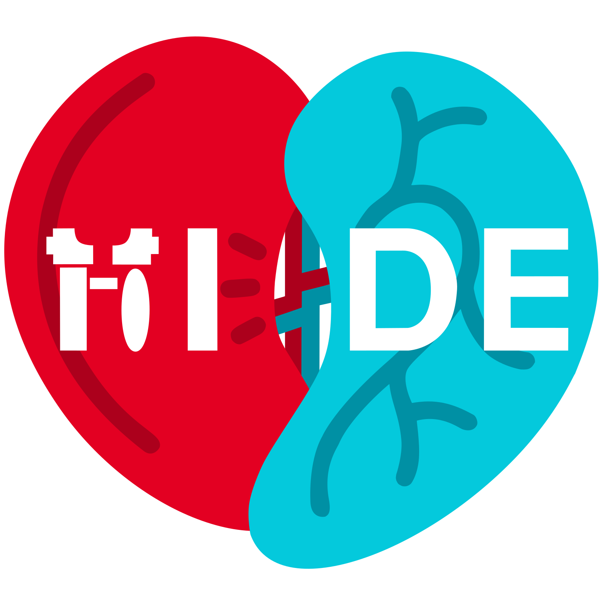

<p align="center">
  
</p>

# HUSH

**H**uman genome **U**niversal **S**ilencing **H**airpin-designer - an
allele-aware siRNA/shRNA design pipeline for polymorphic gene families.

Give HUSH a target transcript and, optionally, a panel of related sequences. It
enumerates siRNA candidates, screens them against the classical efficacy rules
and off-target filters, identifies conserved and polymorphic regions for
pan-allele or allele-specific knockdown, and converts the selected candidates
into cloneable stem-loop shRNA constructs.

HUSH is motivated by the **HLA** system, one of the most polymorphic loci in the
human genome; its allelic diversity is the reason for the allele-aware stage.

HUSH is developed as part of **Project HIDE** 
(HLA Interference through Disguise and Erasure).

## Quickstart

From a clone of this repository, with nothing else installed but Docker:

```bash
docker compose run --rm reference-build   # one-time, see below
docker compose up hush
```

Then open <http://localhost:8000> for the web GUI. Compose builds the image
from this repository's own Dockerfile, so these commands depend on nothing but
the source you already have. The container carries everything else, including
the `bowtie1` binary the off-target check needs.

A prebuilt image is published for convenience. It is pinned to an exact
version, never a moving tag, so a given revision of this repository always
names the image built from it:

```bash
docker run --rm -v hush_ref:/data/reference ghcr.io/theragnaroek/hush:1.1.0 hush reference build
docker run -p 8000:8000 -v hush_ref:/data/reference ghcr.io/theragnaroek/hush:1.1.0
```

For the CLI rather than the GUI:

```bash
docker run --rm -v "$PWD:/work" -w /work -v hush_ref:/data/reference \
  ghcr.io/theragnaroek/hush:1.1.0 hush design mytarget.fasta -o selected.tsv
```

See [`docker/README.md`](docker/README.md) for Compose, the launcher wrappers and
the configuration variables.

## The reference check

The transcriptome off-target check tests whether the guide strand also matches
other transcripts and would therefore silence them (**off-targets**). It is
**on by default** and needs no flag once the reference exists.

The reference is not shipped with the image because it tracks a live RefSeq
release. Fetch it once with `hush reference build`; every later run finds it
automatically. `hush reference status` reports the RefSeq release, the bowtie
version and the build date recorded in the index manifest.

HUSH also runs without the built reference, for example to use a different
reference genome (another version or species). In that case the CLI prints an
`UNREFERENCED RUN` warning and the design TSV has an `offtarget_checked` column,
so an empty off-target hit count cannot be mistaken for "no off-targets found".

## Install from source

```bash
python -m venv .venv
# Windows:  .venv\Scripts\activate
# POSIX:    source .venv/bin/activate
pip install -e ".[dev,api]"
```

To install the exact versions HUSH was built and tested with, use the lockfile
instead - this is what the container does, and what to use when reproducing
results:

```bash
pip install -r requirements.txt -r requirements-dev.txt
pip install --no-deps -e .
```

The lockfile needs Python 3.12 or newer, because numpy 2.5 does not support 3.11.
On 3.11, use the first command.

All dependencies install with pip except **bowtie1**, which is used only for the
transcriptome off-target search. Install it from a package manager or bioconda,
or use the container, which already contains it. The design engine, the MSA stage,
the conversion stage and the tests run without any external binary.

## Usage

### Interactive shell

`hush shell` keeps one session open: load the target and panel once, adjust the
criteria, then re-run `design` and `convert` without re-reading the inputs. The
panel alignment is computed once and reused.

```
hush> load data/examples/target_example.fasta
hush> panel data/examples/hla_panel_example.fasta
hush> set --no-seed --allele-specific "HLA-DEMO*01:01"
hush> design
hush> convert --loop jensen
hush> save run1/
```

`help` inside the shell lists every command. The commands below run once per
invocation and are the way to script HUSH.

### Inspect an input

```bash
hush inspect data/examples/target_example.fasta \
  --panel data/examples/hla_panel_example.fasta
```

A **protein** target (for example parsed from a PDB structure) is flagged:
design needs the coding transcript, so a protein must first be resolved to its
mRNA/CDS.

### Design siRNA candidates

```bash
hush design data/examples/demo_lowgc_cds.fasta -o selected.tsv
```

HUSH enumerates every candidate site (default: 19-nt core, 2-nt 3' overhangs) and reports
those that pass the enabled gates. It is a **filter, not a score**: every gate is
explicit and each candidate keeps its per-criterion breakdown, so every verdict
can be traced. The run prints the criteria, a funnel (the number of candidates
that pass each gate) and the selected table.

> **GC-rich families:** the seed filter follows Ui-Tei et al. (2008) and Naito et
> al. (2009) and is strict. On a very GC-rich coding sequence such as HLA it may
> reject every candidate. Relax it there with `--no-seed`.

Every flag, its default and what it does: [`docs/cli.md`](docs/cli.md), or
`hush design --help`.

### Allele-aware design

`--panel` enables the MSA stage: the panel is aligned to the target, and each
candidate is additionally gated on whether its window **hits** the alleles to be
silenced and **discriminates** against the alleles to be spared.

```bash
# Conserved sites across the whole family (the default intent)
hush design target.fasta --no-seed --panel panel.fasta

# Hit one panel member, discriminate against the rest
hush design target.fasta --no-seed --panel panel.fasta \
  --allele-specific "HLA-DEMO*01:01"

# Silence the loaded target, spare the whole reference panel
hush design target.fasta --no-seed --target-specific --panel panel.fasta --explain
```

A request that spares something is ranked by discrimination by default, and the
table gains `minDiff` and `disc` columns that describe the **weakest** spared
allele, the allele that the window distinguishes least well. `--explain` prints
the per-allele breakdown. See [`docs/design-rules.md`](docs/design-rules.md).

### Convert to shRNA

```bash
hush convert selected.tsv --loop jensen -o shrna.tsv
```

Each selected candidate's **full strands** - paired core plus 3' overhang - are
grafted onto a stem-loop scaffold in the sense-loop-antisense orientation, so
the hairpin expresses exactly the guide the design stage validated. Output is
the bare insert as top/bottom DNA oligos plus a Pol III poly-T terminator,
vector-agnostic: add your vector's sticky-end tails before cloning.

Constructs whose body carries a premature Pol III terminator are withheld by
default and counted in the summary; `--keep-premature-terminators` shows them.
Details in [`docs/shrna-conversion.md`](docs/shrna-conversion.md).

## HTTP API and web GUI

The container serves both on port 8000. To run them from a source checkout:

```bash
python -m api          # API on :8000, or: uvicorn api.app:app --reload
cd web && npm run dev  # GUI on :5173, proxying the API
```

Interactive API docs are at `/docs`, the OpenAPI schema at `/openapi.json`. See
[`docs/api.md`](docs/api.md) and [`web/README.md`](web/README.md).

## MCP Server

HUSH includes an optional MCP server. It makes the `design`, `convert` and
`reference build` commands available to AI applications.

### Requirements

Install HUSH as described in "Install from source", but use the MCP lockfile:

```bash
pip install -r requirements-mcp.txt
pip install --no-deps -e .
```

Like the other lockfiles, it needs Python 3.12 or newer. On Python 3.11, use
`pip install -e ".[mcp]"` instead.

Then note the absolute path of the `hush` executable in the virtual environment. It
is in `.venv/Scripts` on Windows and in `.venv/bin` on Linux and macOS.

### Connecting to an AI application

This configuration was validated with Claude Desktop version 2.42304.2.

In Claude Desktop, open the configuration file under Settings > Developer > Local
MCP servers > Edit config. Insert the following inside the outer `{}` brackets, and
replace `<path to hush directory>` with the absolute path of the HUSH directory:

```json
"mcpServers": {
  "hush-sirna": {
    "command": "<path to hush directory>/.venv/Scripts/python[.exe]",
    "args": [
      "<path to hush directory>/mcp/mcp_server.py"
    ],
    "env": {
      "HUSH_EXECUTABLE": "<path to hush directory>/.venv/Scripts/hush[.exe]"
    }
  }
}
```

With this configuration, Claude Desktop starts the MCP server when the application
opens. The server reads input files from local paths, so every input file must be
accessible on the machine that runs it.

## Test Suite

Install from the lockfile first so that the versions match. The suite includes the
46-siRNA Amarzguioui Table 3 exact-reproduction fixture:

```bash
pytest -q
```

The bowtie parity test is skipped when `bowtie` is absent. Run the tests in the
container to cover that path; see [`docs/development.md`](docs/development.md).

## Documentation

| Document | Covers |
|---|---|
| [`docs/architecture.md`](docs/architecture.md) | How the stages and layers fit together, and where a change belongs |
| [`docs/design-rules.md`](docs/design-rules.md) | The science: every gate, why it exists, and its sources |
| [`docs/shrna-conversion.md`](docs/shrna-conversion.md) | Stage 4: hairpin geometry, loops, QC read-outs |
| [`docs/cli.md`](docs/cli.md) | Every command and flag |
| [`docs/api.md`](docs/api.md) | HTTP endpoints and request/response shapes |
| [`docs/development.md`](docs/development.md) | Tests, layout, conventions |
| [`docker/README.md`](docker/README.md) | Running and building the container |
| [`docs/igem-mirror.md`](docs/igem-mirror.md) | The frozen iGEM GitLab copy |

## Project layout

```
core/     Domain model and the siRNA design engine
msa/      MSA / allele stage (alignment, variation, windows, targeting)
shrna/    shRNA conversion (loops, convert)
service/  HushSession, the orchestration layer used by the CLI and the API
app/      CLI (cli.py) and interactive shell (shell.py)
api/      FastAPI backend over the same session layer
web/      React + Vite browser client
data/     Small example and panel FASTAs
tests/    pytest suite
docker/   Dockerfile and launcher wrappers
```

## Development

```bash
pytest
cd web && npm run typecheck && npm run lint
```

The bowtie parity test is skipped when `bowtie` is not on PATH. See
[`docs/development.md`](docs/development.md).

## Data, models and disclosure

**No AI or machine-learning model is used.** HUSH is a deterministic,
rule-based pipeline: every verdict comes from a published criterion or a
thermodynamic calculation, and the same input always gives the same output. No
model is trained, fine-tuned or called at runtime, and no commercial model API
is contacted. An ML efficacy layer was considered and is out of scope; the
reasoning is in [`docs/design-rules.md`](docs/design-rules.md).

**The repository contains no large files.** The only large artefact is the
transcriptome off-target index, which is built on the user's machine by
`hush reference build` directly from the NCBI RefSeq FTP site. It is not
redistributed, so the reference always matches a RefSeq release that the user can
name, and the index manifest records which one.

**Dependencies are pinned.** `requirements.txt`, `requirements-dev.txt`, `requirements-mcp.txt` and
`web/package-lock.json` record the exact versions used; `pyproject.toml` holds
the supported ranges.

## Credits

HUSH was developed by iGEM GU Frankfurt 2026 as part of Project HIDE (HLA
Interference through Disguise and Erasure).



- Dennis Ragnar van Reem - project management, programming, research
- Florian Symalla - programming, research
- Leonie Schallmey - research
- Lucas Koch - programming, research
- Itzel Jaimes Jaramillo - design

<br clear="right">

Anthropic's Claude (through Claude Code) assisted in the implementation of HUSH.
HUSH itself uses no AI model at runtime; see
[Data, models and disclosure](#data-models-and-disclosure). Thank you to
[Anthropic](https://www.anthropic.com) for partnering with iGEM for the 2026
competition.

To cite HUSH, see [`CITATION.cff`](CITATION.cff). GitHub's "Cite this
repository" button reads it.

## License

MIT. See [`LICENSE`](LICENSE).
